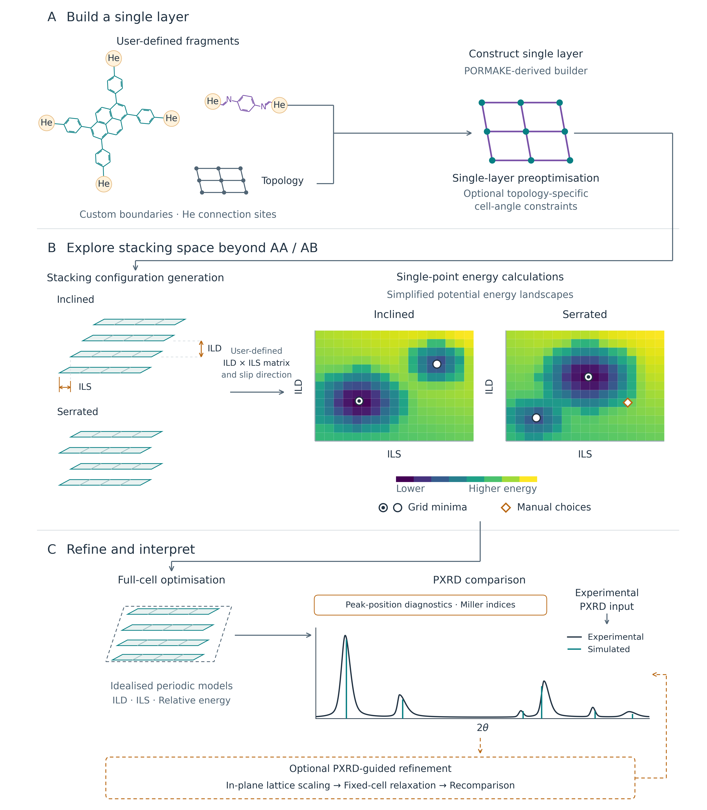
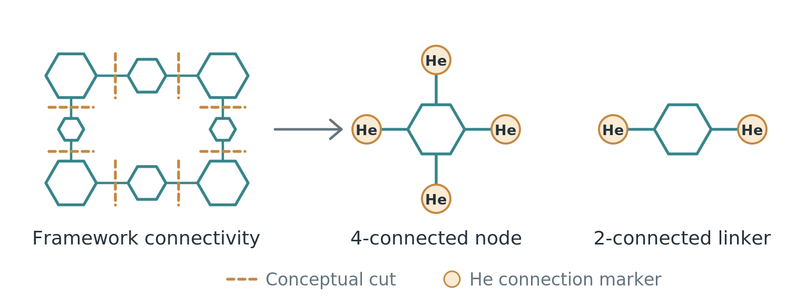
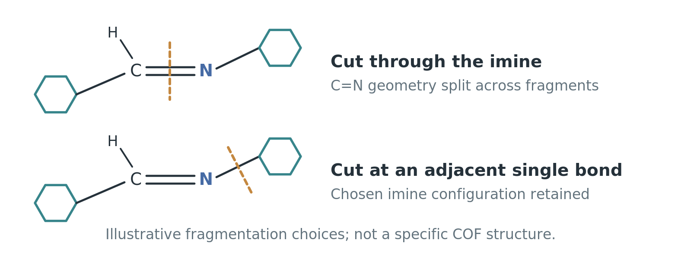
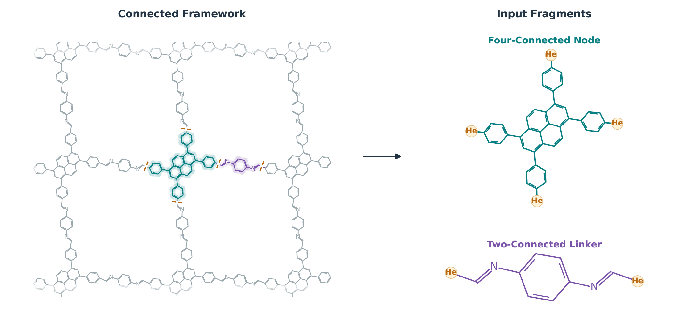
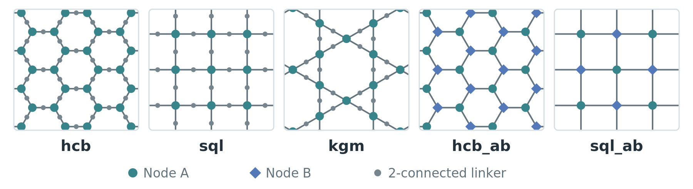

<p align="center">
  
</p>

<h1 align="center">COF-Landscaper</h1>

<p align="center"><strong>Build covalent organic frameworks and explore how their layers stack.</strong></p>

COF-Landscaper gives experimental chemists a notebook workflow for turning molecular fragments into periodic framework models. For a 2D COF, it constructs a layer, varies the spacing and lateral displacement between layers, and ranks the sampled arrangements by energy. Relax the most promising candidates and compare their simulated powder X-ray diffraction (PXRD) patterns with your measurement. Several arrangements can give similar patterns, so use the comparison alongside other structural evidence.

**[Installation guide](examples/installation/README.md)** · **[Choose an example](#examples)** · **[Prepare building blocks](#prepare-the-building-blocks)** · **[Documentation and data sources](#documentation-and-data-sources)**

<p align="center">
  
</p>

## Installation

[Standard installation](examples/installation/README.md#standard-installation) · [Advanced installation](examples/installation/README.md#advanced-installation)

## Examples

| Workflow | System | What you can do |
| --- | --- | --- |
| [Default notebook](examples/main_workflow/local/default/default.ipynb) | ILCOF-1 | Build a layer, screen its stacking arrangements, relax the selected structures and compare PXRD with experiment. Start here. |
| [Configurable notebook](examples/main_workflow/local/configurable/configurable.ipynb) | ILCOF-1 | Choose the energy model, slip direction and sampling grid. The example screens 28 serrated arrangements. |
| [2D HPC driver and inputs](examples/main_workflow/hpc/) | ILCOF-1 | Run the calculation on a cluster, then inspect the downloaded landscape, structures and diffraction patterns in the [analysis notebook](examples/main_workflow/hpc/pxrd_analysis.ipynb). |
| [3D driver and inputs](examples/additional/3d/) | BP-COF-1 | Assemble the eight-connected `bcu` framework, relax the full cell and simulate PXRD. |
| [Optional scaling notebook](examples/additional/scaling/scaling.ipynb) | COF-LZU-1 | Inspect peak offsets and explore an optional in-plane lattice adjustment using selected reflections. |

## Prepare the building blocks

Start from the framework you want to model. Choose a topology, then divide the bonded framework into molecular fragments with the required number and arrangement of connections. Choose the cuts to preserve the chemistry that matters. Cutting a single bond next to an imine, for example, keeps the C=N bond and its intended E or Z geometry within one fragment.

<p align="center">
  
  
</p>

Place one helium atom (`He`) on each side of a cut to mark where the opposite fragment should connect. These markers guide assembly and are removed when the fragments are joined. In ILCOF-1, the four-connected pyrene node joins a two-connected linker that retains both imines. [Node XYZ](examples/main_workflow/local/default/0_node/ILCOF-1_node.xyz) · [Linker XYZ](examples/main_workflow/local/default/0_linker/ILCOF-1_linker.xyz)

<p align="center">
  
</p>

### Prepare the XYZ files in Avogadro 2

1. Draw or import each fragment with the intended bond orders and stereochemistry. [Drawing molecules](https://avogadro.cc/docs/getting-started/drawing-molecules.html)
2. If the coordinates need preoptimisation, select UFF and run **Extensions → Optimize Geometry**. [Force-field settings](https://avogadro.cc/docs/menus/extensions-menu.html#configure)
3. Once the geometry is ready, add one He per connection along the intended bond direction, replacing any capping hydrogen at that site.
4. Export each fragment as XYZ via **File → Export → Molecule…**. Put nodes in `0_node/` and any linkers in `0_linker/`. [Exporting molecules](https://avogadro.cc/docs/getting-started/saving-files.html#exporting-to-other-formats)

Inspect the bond geometry at the joins and check for clashes in the assembled layer before scanning its stacking arrangements.

### Supported 2D topologies

<p align="center">
  
</p>

Each entry gives the number of distinct XYZ files × He markers per file. The two binary topologies join the two node types directly.

| Topology | Keyword | Nodes | Linkers |
| --- | --- | --- | --- |
| Honeycomb | `hcb` | 1 × 3 | 1 × 2 |
| Square lattice | `sql` | 1 × 4 | 1 × 2 |
| Kagome | `kgm` | 1 × 4 | 1 × 2 |
| Binary honeycomb | `hcb_ab` | 2 × 3 | None |
| Binary square lattice | `sql_ab` | 2 × 4 | None |

For a 3D example, BP-COF-1 uses an eight-connected node and a two-connected linker on the `bcu` net. [3D configuration](examples/additional/3d/cof-landscaper_3d.params.json)

## Documentation and data sources

Use this README and the example notebooks for practical instructions and guidance on interpreting results. The API reference on Read the Docs is under development. [Example workflows](#examples) · [Read the Docs](https://cof-landscaper.readthedocs.io/)

The example data record lists the framework publications, experimental PXRD sources and wavelengths, and the origin of the computational results. [Example data sources](examples/DATA_SOURCES.md)

## Citation and contact

When reporting results, cite **Gregor Lauter, COF-Landscaper (software)** with the version you used and the repository URL. Also cite the experimental data and energy model used in your study. [Software repository](https://github.com/GregorLauter/COF-Landscaper) · [Version tags](https://github.com/GregorLauter/COF-Landscaper/tags)

Report software problems on [GitHub Issues](https://github.com/GregorLauter/COF-Landscaper/issues). For help preparing fragments, using the workflow or discussing a collaboration, contact [Gregor Lauter](mailto:gjl342@student.bham.ac.uk).

## Development

From a source checkout with uv and just installed, set up the developer environment and run the repository checks. The package is distributed under the [MIT licence](LICENSE).

```bash
just setup
```

```bash
just check
```
