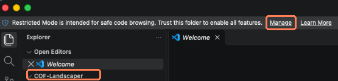
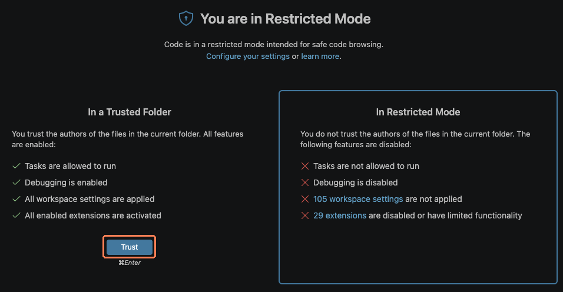
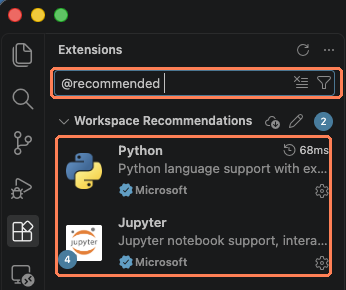
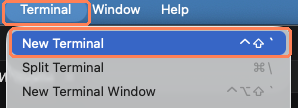
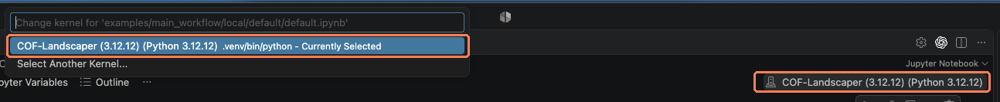

# Install COF-Landscaper

[Beginner's Guide](#beginners-guide) · [Your research projects](#your-research-projects) · [Further Installation Options](#further-installation-options)

<a name="standard-installation"></a>

## Beginner's Guide

### 1. Install VS Code

Download and install Visual Studio Code for your operating system. [Download VS Code](https://code.visualstudio.com/download)

### 2. Download COF-Landscaper

Download [COF-Landscaper.zip](https://github.com/GregorLauter/COF-Landscaper/releases/download/v2026.11.26.0/COF-Landscaper.zip).

### 3. Extract the folder

Extract **COF-Landscaper** to a permanent location, such as **Documents**, before installing the environment. This folder will be your working directory.

### 4. Open the folder in VS Code

In VS Code, choose **File → Open Folder** and select the extracted **COF-Landscaper** folder.



### 5. Trust the workspace

If you trust the folder's source, accept the workspace trust prompt. If VS Code shows **Restricted Mode**, select **Manage → Trust**.



### 6. Install the recommended extensions

Open **Extensions** and enter the following in the search box.

```text
@recommended
```

Install **Python** and **Jupyter**, both published by Microsoft.



### 7. Open the integrated terminal

Choose **Terminal → New Terminal** in VS Code.



### 8. Install uv

Run the command for your operating system in the terminal. [uv installation instructions](https://docs.astral.sh/uv/getting-started/installation/)

**macOS**

```bash
curl -LsSf https://astral.sh/uv/install.sh | sh
```

**Windows** (PowerShell with WinGet)

```powershell
winget install --id=astral-sh.uv -e
```

### 9. Install the notebook environment

Close and reopen the terminal, then run the following command and wait for it to finish.

```bash
uv sync
```

If uv is not recognised, restart VS Code, reopen the **COF-Landscaper** folder and run `uv sync` in a new terminal.

### 10. Open the notebook and check the import

In the Explorer, open [examples/main_workflow/local/default/default.ipynb](../main_workflow/local/default/default.ipynb).

Check the kernel shown at the top right. If **COF-Landscaper** with **Python 3.12** is already selected, continue. Otherwise click **Select Kernel → Python Environments** (via **Select Another Kernel** if shown) and choose the workspace's `.venv` interpreter.



Click **Run Cell** beside the first cell.

```python
import coflandscaper as cl
```

A check mark indicates success. The first import may take longer than subsequent imports.

**You can now close the terminal and start using COF-Landscaper.**

## Your research projects

Create project folders and nested subfolders anywhere inside the main **COF-Landscaper** workspace, including alongside `examples/`. Keep each notebook with its input folders. For example, a project called MyCOF could use this layout.

```text
COF-Landscaper/
├── examples/
└── research/
    └── MyCOF/
        ├── workflow.ipynb
        ├── 0_node/
        ├── 0_linker/
        └── experimental_pxrd/
```

Use the same **COF-Landscaper** kernel for these notebooks. Keep the workspace in its installed location and retain `.venv/`, `.vscode/`, `.python-version`, `pyproject.toml` and `uv.lock` at its root.

<a name="advanced-installation"></a>

## Further Installation Options

### Editable installation

Use Python 3.12 to install an editable copy of the repository.

```bash
git clone https://github.com/GregorLauter/COF-Landscaper.git
cd COF-Landscaper
python -m pip install -e ".[notebook]"
```

### GPU and HPC

For CUDA-enabled GPU execution, change `CALCULATOR_KWARGS.device` from `"cpu"` to `"cuda"` in the JSON configuration. Configure a compatible GPU software environment for your system.

Use the supplied Python driver and matching JSON configuration for cluster calculations. Follow your cluster's procedures for installation, resource allocation and job submission. [2D driver and JSON](../main_workflow/hpc/) · [3D driver and JSON](../additional/3d/)

Report COF-Landscaper-specific problems on [GitHub Issues](https://github.com/GregorLauter/COF-Landscaper/issues).
